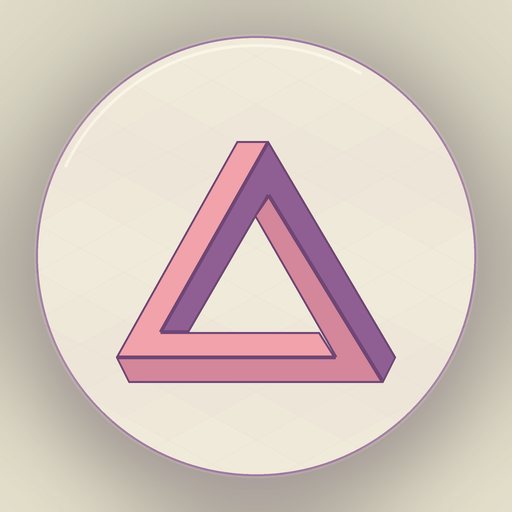

# dsh-splash

**简体中文** | [English](README.en.md)

<p align="center"></p>

DSH 启动开屏插件：彭罗斯三角在等距菱格海面上旋转受光，取景框本身就是进度计，读取 **真实启动进度**；默认 7.2 秒、按任意键可跳过，附带 10 套主题色板。开屏结束后三角不消失，缩到输入框左侧常驻，成为一枚会跟着工作状态变化的小标记。

视觉测试台：`preview/preview.html?mode=static`（用真实 bundle 跑假服务，可直接用浏览器打开）。

## 效果与交互

- 彭罗斯三角 18s 一圈原地旋转，三块面同步做受光循环；海面是双正弦波位移的等距菱格。
- **没有进度条、没有按钮**：取景框本身就是进度计，宽高与圆角随进度从 380px 推到铺满窗口，百分比是框内底部的大号数字。
- 默认 **7.2s** 固定开屏时间线，主题坞里用滑块改成 1–12 秒；**按任意键**跳过（单独按修饰键不算，`F5` / `Ctrl+R` 仍然可用，所以刷新不会把开屏吞掉）。
- 启动进度仍然由真实里程碑驱动（见下一节）；电影节奏只是让进度按时间线平滑走，且以真实完成度为上限。
- **收尾**：100% 时停留一拍，取景框与海面褪掉，三角自己飞向输入框左侧外缘，缩成常驻标记。
- **常驻标记**：恒定慢转（18 秒一圈，不浮动），读取 DSH 写在 DOM 上的 `data-process-activity`，按思考 / 查找 / 执行 / 改文件四种状态**只换配色、不改转速**（转速一变就像在挣扎）；转速只受推理强度影响，四档拉得很开（Off 0.5× / Low 0.72× / High 1× / Max 1.7×，即 36 秒到 10.6 秒一圈）。窗口太窄、左侧放不下、或切到设置页时自动隐藏。
- **主题入口**：会话顶部导航栏工具区（文件夹、更多、面板按钮同一排）的小彭罗斯三角图标；悬停会高亮（**不变速**，变速会让角度跳）。面板提供 10 套色板、停留时长滑块、每天只播一次、常驻标记开关和预览；任何操作都不会收起面板，预览结束后面板还在。开屏期间换色是实时的；停留时长下一次开屏生效。

## 主题与色板

主题坞里的色板来自你的两个参考目录：

- **Monument Valley**（`E:\mv-refs\palette.json`）：丁香之绽（默认）、紫金一瞬、青绿山水、陶土记忆、月下幽紫。
- **Geometric Islands**（`E:\web\Geometric Islands\style.css`）：碧空如洗、芽头新绿、风起黄昏、薰衣旧梦、夜生白露。

每套色板同时驱动背景、圆框、文字、海面格子和彭罗斯三面的受光；暗色主题也做了对应的文字/边框对比。常驻标记在空闲时沿用当前色板的三角配色，进入工作状态后换成固定的四种工作色（冷钢蓝 / 青 / 琥珀 / 紫），保证任何色板下都能一眼分辨。主题保存在 `localStorage`（`dsh-splash:settings`），不写宿主配置，也不跨设备同步；开屏还在屏幕上时切换色板会即时生效。

## 真实进度，不是假进度

进度只有一种节奏（电影），面板不再提供切换——开屏随时可按任意键跳过，手动切「真实」没有必要：

- **电影**：目标值 = `min(真实完成度, 时间线进度)`。时间线用 ease-out 在开屏时长内推进，所以进度会持续动；但它**只能慢于真实，不能超过真实**——只有真实启动完成、并且时间线走到结尾，才会到 100。真实完成后、时间线没走完时，阶段显示“正在进入”，不会早早 100% 停住。
- **真实**：目标值 = 真实完成度。启动很快时会迅速到 100，适合排障或想看原始数据时使用。

真实进度仍然由五个加权里程碑组成，总和 100：

| 阶段 | 权重 | 数据来源 |
|---|---|---|
| 页面装载 | 5 | `document.readyState === 'complete'` |
| 客户端插件图 | 50 | `ctx.get('modules').manifest.plugins.length` 与 `ctx.loader.entries()` 的 fiber 状态 |
| 连接 Host | 17 | `ctx.get('connection').state`（`connecting → connected`） |
| 工作区 / 会话基线 | 18 | `ctx.get('workspaces').list` 与 `ctx.get('sessions').list` 的 `phase === 'ready'` |
| 首帧与字体 | 10 | 挂载后的两帧 rAF + `document.fonts.ready`（最多等 800ms） |

显示值只对目标值做视觉缓动（`1 - e^(-dt/110)`）；阶段文案会显示 `正在载入插件 37/94` 这类真实计数。电影模式的时间线只是**下限节奏**，不会把未完成的启动报成已完成。

**开屏时长和进度是两件事**：7.2s 是“至少展示”的固定时间线；启动很快时进度会按时间线平滑走完，启动很慢时则以真实完成为准继续等待。按任意键随时可以提前结束。

因为 `shell.overlay` 只在 React 应用挂载后才存在，插件在 `apply` 阶段先把自己的 DOM 画到 `document.body` 上（盖住内核自带的 “Loading plugins…” 启动页），等 `shell.overlay` 的 seat 挂载后，把**同一个 DOM 节点**重新挂到 seat 里，视觉上零闪烁。这样启动前半程（插件图装载）也能显示真实进度。

## 安装到本地 profile

插件是普通的 DSH 客户端插件包：host 半为一个空 Cordis 插件，`package.json` 的 `dsh.client` 让 `dsh-client-modules` 把 `lib/client.js` 作为浏览器 bundle 提供。`dsh.bundle.patch` 让它也能作为 bundle 被插件市场安装。

### 本地开发版（link）

```powershell
# 1. 把包链接进 profile（会写 package.json / pnpm-lock.yaml）
dsh plugin --profile desktop add "link:C:\path\to\dsh-splash"

# 2. 在 profile 的 cordis.patch.yml 末尾登记一行
#    （若通过插件市场/ bundle 方式安装，这一步由 cordis.patch.yml 自动完成）
- id: dsh-splash
  name: dsh-splash
```

DSH 的 HMR 会监听 profile patch 的变化并重组；浏览器端通过 `/plugins/events` 收到新的模块图。**刷新页面（Ctrl+R）** 后即可看到开屏。

### 发布版

```powershell
dsh plugin --profile desktop add dsh-splash
```

截至 2026-11-04，npm `latest` 是 **0.1.0**；0.2.0 的长开屏与主题坞目前是本地 `link:` 开发版，确认效果后再发布。发布后这条命令就会拿到新版。

如果通过 DSH 插件市场安装，包的 `cordis.patch.yml` 会插入同样的 row，无需手写。

### 回滚

从 profile 的 `cordis.patch.yml` 删除 `dsh-splash` row，再执行：

```powershell
dsh plugin --profile desktop remove dsh-splash
```

## 开发流程

```
dsh-splash/
  package.json          # dsh.client / dsh.bundle 声明
  cordis.patch.yml      # bundle 安装时插入的 loader row
  lib/index.js          # host 半：空插件，只为让 Loader 有 entry
  lib/client.js         # 浏览器半：__ModuleLoader__ factory bundle
  preview/preview.html  # 用假 React/假服务跑真实 client.js 的测试台
  test/dom-smoke.mjs    # Node DOM 仿真冒烟测试（进度、adopt、淡出）
```

关键点：

1. **host 半必须存在**。`dsh-client-modules` 只扫描已启用的 Loader entry；没有 host row 就不会有浏览器 bundle。空 `apply()` 就够了。
2. **client 入口由 `exports["./client"]` 指定**，内容必须是 `window.__ModuleLoader__.load({ id, factory })` 形式；`factory(require)` 里只能 `require` 平台基线模块（`react`、`react/jsx-runtime`、`@deepseek-ai/dsh-client-ui-primitives` 等）。需要额外模块时写进 `dsh.client.external`。
3. **用 `ctx.slots.inject('shell.overlay', ...)` 注册**，不要直接注册 `root`。`shell.overlay` 是 root 作用域的 list slot，天然叠加、默认点击穿透，条目自己决定是否接收指针事件。
4. **改完 `lib/client.js` 后**，HMR 会按文件 revision 重载该插件；如果没有自动刷新，重启页面。开发期间可用 `?dsh-splash=force` 在已启动的页面上强制显示，用 `?dsh-splash=off` 关闭。
5. **测试**：

```powershell
node test/dom-smoke.mjs
```

会用 Node 的 DOM 仿真执行真实的 `lib/client.js`，验证冷启动检测、真实 loader 计数、进度单调、`shell.overlay` adopt、淡出与清理、主题坞的 10 套色板 / 时长滑块 / 两个开关 / 预览生命周期，以及常驻标记的五态切换与推理强度倍率。`preview/preview.html?mode=static` 是纯前端视觉测试台（真实 bundle + 假服务），可直接用浏览器打开。

## 配置

产品默认不暴露开关；开发和排障可用：

| 入口 | 作用 |
|---|---|
| `?dsh-splash=off` | 本次不显示 |
| `?dsh-splash=force` | 即使页面已经挂载也显示（用于开发） |
| `?dsh-splash-min=3800` | 本次开屏最短展示时间（毫秒），默认 7200 |
| `?dsh-splash-palette=island-night` | 本次强制使用某套色板 |
| `?dsh-splash-progress=real` | 仅调试用：本次切到真实进度（面板已不再暴露该开关） |
| `window.__DSH_SPLASH__ = { minVisibleMs, palette, progress, force, disabled, debug }` | 脚本注入方式 |

`minVisibleMs` 是开屏时间线长度，电影模式下进度按它平滑走；它不会把未完成的启动报成已完成。正常用户通过顶部导航栏的主题图标修改，不需要手写 query。

## 已知边界

- 开屏是**页面级**的：Electron 原生窗口创建到页面脚本执行之间没有可注入的时机；这段仍由桌面壳自己的窗口背景承担。
- 首次加载后 `shell.overlay` 才存在，所以采用“先画到 body，再 adopt 进 seat”的两段式；如果布局插件重载导致 seat 消失，会把节点放回 body，不会丢画面。
- 启动失败时最多覆盖 20s，然后淡出，避免把错误页永久盖住；进度不会假报 100%。
- 依赖 `ctx.loader.entries()`、`ctx.connection`、`workspaces`/`sessions` 服务；任何一项缺失都会在短暂宽限后按“能力不存在”跳过该阶段，而不是卡死。
- 7.2s 是**默认**时间线，不是强制；主题坞可改 1–12s，按任意键可跳过。主题存在当前页面的 `localStorage`，不跨设备同步。
- 画面全部由代码绘制（canvas + SVG），不带任何图片或视频资产，所以包体很小、任意分辨率都清晰。

## 发布到插件市场

市场的数据源是 [awesome-dsh-plugin](https://github.com/awesome-dsh-plugin/awesome-dsh-plugin) 的 `data/plugins/`（一个插件一个 YAML），不是 dshmarket 仓库。完整流程——GitHub 仓库、`dsh-plugin` topic、npm 发布、收录 PR、CI 与后续更新——见 [PUBLISHING.zh.md](PUBLISHING.zh.md)。

仓库已建为 [dustcpu/dsh-geometric-splash](https://github.com/dustcpu/dsh-geometric-splash)，收录 YAML 已备好：[market/dustcpu__dsh-geometric-splash.yml](market/dustcpu__dsh-geometric-splash.yml)。本包已声明 `dsh.bundle`、`dsh.client`、`engines.dsh`，并带有 `cordis.patch.yml`，满足收录的 manifest 要求。

## License

MIT
